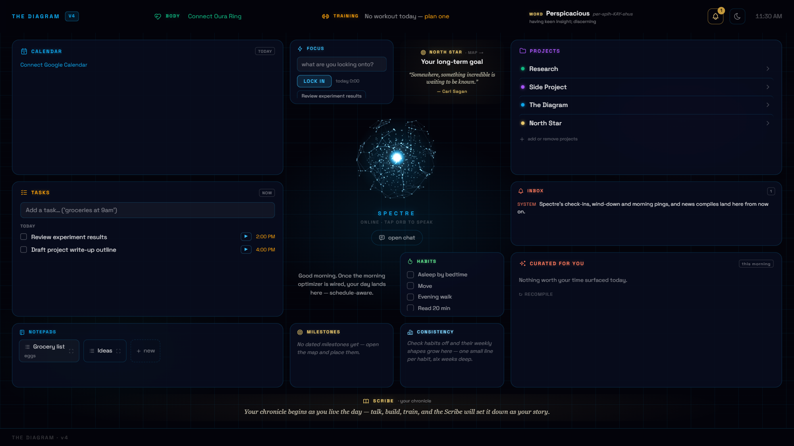
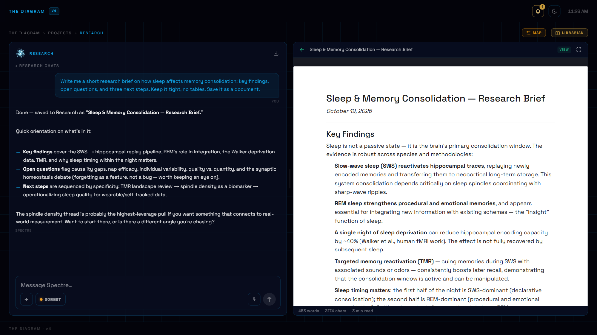
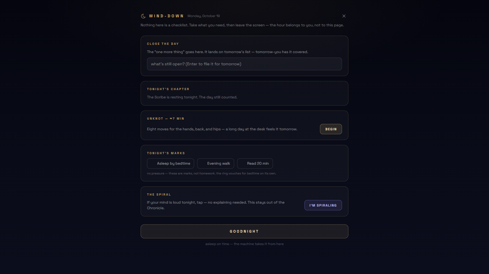

<div align="center">

# The Diagram

**A personal AI operating system: one dashboard, one AI co-pilot, built around one person's life.**



</div>

---

The Diagram is a self-hosted, local-first "personal OS" built with Next.js. At its center is **Spectre**, an AI co-pilot that lives in an orb in the middle of the screen and can see and act on every part of the system: your calendar, tasks, projects, documents, training log, sleep data, and past conversations. Around the orb sits a dashboard laid out by importance.

Most AI tools are general-purpose by design. The Diagram goes the other way. It is meant to be **hard-coded to a single life**, so its structure, its rhythm and the assistant's personality are all shaped around the one person who uses it. This public version ships with neutral defaults. Fork it, then make it yours (see [Make it yours](#make-it-yours)).

> **Status:** a student passion project built over one summer. I'm sharing it mainly for the idea, and as a starting point for anyone who wants a personal AI system of their own. It is not a polished product. Expect rough edges, and expect to read code.

## Contents

- [Design principles](#design-principles)
- [What's inside](#whats-inside)
- [Architecture](#architecture)
- [Getting started](#getting-started)
- [Make it yours](#make-it-yours)
- [Project layout](#project-layout)
- [Caveats](#caveats)

## Design principles

- **Build for the worst day.** Sustainability matters more than raw efficiency. The system should still help when you're exhausted, behind, and not thinking clearly.
- **Hard-coded to one person, not modular.** Generic "productivity" tools fit everyone a little. This one aims to fit one person well.
- **Time of day is a first-class input.** Spectre always knows where you are in your day: morning, deep work, wind-down, night. It changes how it behaves to match.
- **The assistant initiates.** Spectre reaches out at the known failure points (the wind-down, the morning), not only when it's asked.
- **One integrated system.** Projects, schedule, body, and goals live in one tree, so the assistant can connect them without being asked.
- **Honesty about actions is absolute.** Spectre only says it did something if a tool actually did it.
- **Local-first.** Your data lives in SQLite on your own machine. Memory, embeddings, vector search, speech and even the language model can all run locally, with cloud services as a fallback.

## What's inside

### The Operator: orb + chat
The center of the screen is the **orb**. Tap it to talk by voice, or type into the chat beneath it. The chat streams responses with Markdown, code and KaTeX math, and accepts attachments (PDF, images, text, DOCX) by paperclip, paste or drag-drop. Sessions persist in SQLite. Long conversations are compressed recursively (older turns fold into summaries) instead of being cut off. You can edit, retry, search and export them.

A model selector switches between **Claude** (Haiku / Sonnet / Opus) and a **LOCAL** model (`gpt-oss:20b` on llama.cpp). A reasoning dial (LOW / MED / HIGH) trades speed for depth.

### Spectre's tools: an assistant that drives the UI
Spectre acts through a unified tool registry with an agentic loop. It doesn't just answer; it operates the system:

- **Navigation & UI control:** "go to my research project", "pull up that document", "open the chat where we talked about X". Spectre always has the full live tree of the Diagram in context, so it resolves loose names and moves you there.
- **Tasks, calendar, habits, workouts:** create and reschedule tasks with natural-language times, write to Google Calendar (two-way), log sets.
- **Documents:** read, write and create documents, and save anything substantial from chat with one click.
- **Knowledge:** semantic search across your notes and files, plus **chat recall**, which searches and reads any past conversation, so a new chat can pick up where an old one left off.
- **Web search & deep research** (via Tavily).
- **The Secretary:** a delegate agent for bulk task work. It proposes changes, and you review them before anything is applied.

### Dashboard
A fixed, weighted layout. The things you look at most get the most room:

| Area | What it shows |
|---|---|
| **Top bar** | Body-stats glance (Oura), today's training, word of the day, notification bell, wind-down, clock |
| **Left column** | Calendar "day at a glance", **Tasks**, **Notepads** |
| **Center** | The Operator (orb + chat), surrounded by the Focus timer, North Star, a morning note, Habits, Milestones and consistency trends |
| **Right column** | **Projects**, **Inbox**, curated news |
| **Bottom strip** | **Scribe**, today's chronicle as it's being written |

### Core, Arms and Hands
The Diagram is a tree with exactly three levels:

- **CORE:** the main dashboard (Spectre's general conversation).
- **ARMS:** top-level domains: *Schedule*, *Body*, *Projects*, *Training*.
- **HANDS:** items inside an Arm, such as each individual project.

Every node has its own isolated conversation history and an editable **primer** (the instructions Spectre gets when you're there). Spectre's prompt is split into a stable, cacheable prefix and a small per-turn suffix, so both Claude's prompt cache and the local model's KV cache get reused across turns.

### Projects workspace
Each project opens a two-pane workspace. On the left is the project's chat with its session history and color-coded **section tags**. On the right are:

- **Sources:** upload reference files (PDF, images, text). When a file is open, Spectre treats it as a "second screen". Every question you ask searches that document again, so answers come from the exact section that's relevant.
- **Docu-scape:** a document library with a rich-text editor (TipTap). It supports tables, task lists, images, KaTeX math, focus mode, drag-and-drop organization, **ghost-text autocomplete** routed through Spectre, and "thought bubbles" that offer to format what you're writing.
- **The Librarian:** an agent that proposes a tidier organization for a project's documents. You review the plan before anything moves.



### Memory & knowledge
- **Mem0** (self-hosted) pulls durable facts out of conversations and recalls them on later turns.
- **Metalmind Vault:** every document and source file is mirrored to disk as Markdown, so the files folder doubles as an **Obsidian vault**. Everything is also embedded (`nomic-embed-text`) into **Qdrant** for semantic search. Relevant passages are injected automatically each turn.

### Rhythm: the temporal spine
A small set of anchors (wake time, sleep length, wind-down length) generates the whole day's boundaries. Spectre knows the current phase of the day on every turn, and the server sends nudges at the right moments:

- **Wind-down:** at a set hour, Spectre offers a calm end-of-day surface. You capture loose ends as tomorrow's tasks, read tonight's Chronicle chapter, run a short stretch routine, and say goodnight. The job is to hand you *off* the screen.
- **Overthinking containment:** a private late-night chat that contains a spiral of worry instead of feeding it, and parks it for the morning. These sessions are kept out of the Chronicle.
- **Morning push:** one wake-up notification with the day's shape and the nearest milestone.
- **Quiet hours:** routine nudges are held from wind-down until morning.

<p align="center"></p>

### Scribe: your day as a story
A background chronicler collects each day's conversations, tasks and events. From them it writes a running third-person narrative, plus a nightly "chapter", which you can browse in a full-screen Chronicle. It has one hard rule: **zero fabrication.**

### Everything else
- **Tasks + Secretary:** natural-language due times ("groceries at 9am"), a "now" list, calendar-linked time blocks, and a project map of steps.
- **Notepads:** quick notes (a phone Notes-app replacement). Promote any line to a task, or enlarge one pad to fill the widget.
- **Habits & Focus:** streaks, some habits that check themselves off automatically (e.g. a workout logged, an on-time bedtime from Oura), and a focus timer linked to tasks.
- **North Star:** a long-term goal map. You place milestones, and dated ones flow onto your calendar.
- **Inbox:** one stream for notifications, proposals and plans.
- **Training:** a day-by-day gym log with drag-to-reorder blocks, per-set logging, rest timers and e1RM/PR tracking.
- **Body:** live Oura Ring data (sleep, readiness, HRV, recovery).
- **Deep research:** Quick / Deep / Exhaustive modes. Parallel research agents run on a live DAG view. Deep mode reads full pages (headless Chromium). Exhaustive mode keeps adding agents until the topic stops yielding anything new ("saturation"). You can Stop or Wind Down at any point.
- **Voice:** speech in and speech out. It runs locally (Faster-Whisper STT + Chatterbox TTS with voice cloning) or in the cloud (Groq + Cartesia), with automatic failover.
- **Push notifications** (Web Push, installable as a PWA on your phone).

## Architecture

```
                         ┌──────────────────────────────┐
  Browser / phone (PWA)  │  Next.js app (app/page.tsx)  │  dashboard, orb, chat, workspaces
                         └──────────────┬───────────────┘
                                        │  /api/*
            ┌───────────────────────────┼─────────────────────────────┐
            │                           │                             │
   ┌────────▼────────┐        ┌─────────▼─────────┐         ┌─────────▼─────────┐
   │ Spectre agent   │        │ SQLite            │         │ Background        │
   │ tool registry + │        │ (better-sqlite3)  │         │ schedulers        │
   │ agentic loop    │        │ nodes, sessions,  │         │ Rhythm pushes,    │
   │                 │        │ messages, tasks,  │         │ Scribe, Librarian │
   └──┬──────────┬───┘        │ notebooks, files… │         └───────────────────┘
      │          │            └───────────────────┘
 ┌────▼───┐ ┌────▼──────────────┐   ┌────────────┐ ┌──────────┐ ┌──────────────┐
 │ Claude │ │ llama.cpp :8013   │   │ Mem0 :8000 │ │ Qdrant   │ │ Ollama       │
 │ (API)  │ │ gpt-oss:20b LOCAL │   │ memory     │ │ :6333    │ │ :11434       │
 └────────┘ └───────────────────┘   └────────────┘ └──────────┘ └──────────────┘
   + Tavily (search) · Google Calendar · Oura · Cartesia/Groq or Chatterbox/Whisper (voice)
```

**Stack:** Next.js 16 (App Router) · React 19 · TypeScript · Tailwind CSS 4 · better-sqlite3 · TipTap 3 · KaTeX · Anthropic SDK · llama.cpp · Mem0 · Qdrant · Ollama · Docker.

| Service | Port | Needed for |
|---|---|---|
| Next.js dev server | 3000 | everything |
| Mem0 (Docker) | 8000 | long-term memory |
| Qdrant (Docker) | 6333 | memory + vault search |
| Ollama | 11434 | embeddings (`nomic-embed-text`), Mem0's extractor (`qwen3:1.7b`) |
| llama-server | 8013 | the LOCAL model (optional) |
| Playwright (Docker) | 8009 | full-page fetch for Deep research (optional) |
| Chatterbox / Whisper (Docker) | 8004 / 8005 | local voice (optional) |

Every optional service fails soft. If something is down, that feature degrades quietly (LOCAL falls back to Claude, vault search returns nothing, voice falls back to the cloud) instead of breaking the app.

## Getting started

**Prerequisites:** Node.js 20+, and an [Anthropic API key](https://console.anthropic.com/). Docker + Ollama are optional but recommended (memory + semantic search).

```bash
git clone https://github.com/<your-username>/<this-repo>.git
cd <this-repo>
npm install
cp .env.example .env.local      # add ANTHROPIC_API_KEY and your name
npm run dev                     # http://localhost:3000
```

On first run, the SQLite database (`conversations.db`) is created and seeded with the default tree: four Arms and a few example projects.

**Optional: memory + vault search**

```bash
ollama pull nomic-embed-text
ollama pull qwen3:1.7b
docker compose up -d mem0 qdrant
```

**Optional:**
- **Google Calendar / Oura / Web Push:** fill in the matching keys in `.env.local` (see comments there), then connect from the UI.
- **Local LLM:** see [`local-stack/llm/README.md`](local-stack/llm/README.md) (llama.cpp + `gpt-oss-20b`).
- **Local voice:** `docker compose up -d chatterbox whisper`, after cloning Chatterbox-TTS-Server as described in `docker-compose.yml`.
- **Windows one-click start:** `start-diagram.bat` brings up Docker services, warms Ollama, starts the local LLM and dev server, and (optionally) Tailscale Serve for private access from your phone.

## Make it yours

The point of the project is that it's *yours*. Everything personal lives in a handful of places:

| What | Where |
|---|---|
| Your name | `NEXT_PUBLIC_USER_NAME` in `.env.local` (used through `lib/profile.ts`) |
| Spectre's personality, and what it knows about you | [`spectre_core.md`](spectre_core.md). It's re-read live, no restart needed |
| Your daily rhythm (wake, sleep, wind-down, week shape) | [`lib/rhythm.ts`](lib/rhythm.ts) |
| What each place in the Diagram tells Spectre | The ⚙ primer editor in any chat header |
| Your projects, North Star, habits | Create them in the UI |
| News topics | [`lib/news.ts`](lib/news.ts) |

## Project layout

```
app/
  page.tsx            the whole client: dashboard, orb, chat, workspaces, editor
  components/         SpectreOrb
  api/                ~70 route handlers (spectre, chat, tasks, notebooks, vault, research, tts/stt, oura, …)
lib/
  conversations.ts    SQLite schema, migrations, seeds and queries
  tools/              Spectre's tool registry, executor and agentic loop; the Secretary
  spectreLocal.ts     the LOCAL (llama.cpp) backend: native tool calls and context fitting
  rhythm.ts           the temporal spine
  scribe.ts           the Chronicle
  vault.ts            Obsidian mirror + Qdrant semantic index
  librarian.ts        document-organization agent
  …                   gcal, oura, news, push, search, workouts, etc.
mem0/                 self-hosted Mem0 server (FastAPI)
local-stack/          llama.cpp launcher, Whisper + Playwright containers
spectre_core.md       Spectre's identity (edit me)
```

## Caveats

- **Single-user and not hardened.** There is no login. Run it on your own machine, and reach it remotely over a private network such as Tailscale. **Do not expose it to the public internet.**
- **Built and tested on Windows** with an NVIDIA GPU, for the local model and voice. The web app itself runs anywhere Node does.
- `app/page.tsx` is one very large file. It grew fast. Splitting it up would be a welcome contribution.
- Some features need API keys or services you may not have. They switch off cleanly when those are missing.

## License

[MIT](LICENSE)
